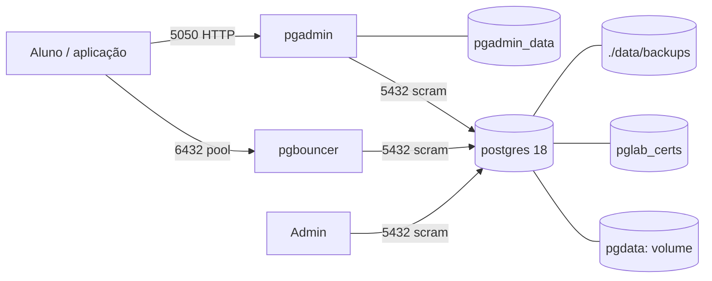

# Arquitetura — VET-Lab Infra

## Contexto

O ambiente existe para sustentar o ensaio de caso do Programa 1: dados de
diagnóstico veterinário e genômica, com espaço para busca vetorial (pgvector) e
rastreabilidade de auditoria, tudo reproduzível na máquina do aluno.

Restrições que moldaram o desenho:

- **Portabilidade**: Windows (Docker Desktop/WSL2), macOS e Linux.
- **Reprodutibilidade**: um comando sobe e configura tudo; nenhum passo manual.
- **Isolamento**: nada além do projeto compartilha o cluster.
- **Custo operacional baixo**: o contêiner cabe em ~1,5 GB de RAM.

## Containers (C4 nível 2)

| Container | Responsabilidade | Estado persistente |
|---|---|---|
| `postgres` | Cluster PostgreSQL 18 + extensões, TLS, auditoria | volume `pgdata` |
| `pgbouncer` | Pool transacional para a aplicação | nenhum (userlist em memória do FS) |
| `pgadmin` | Administração visual | volume `pgadmin_data` |

## Fluxo de inicialização

Apenas na primeira subida (volume `pgdata` vazio):

1. `docker-entrypoint-ssl.sh` gera o certificado autoassinado em `pglab_certs`.
2. O entrypoint oficial roda `initdb` (UTF8, `C.UTF-8`, checksums de página).
3. O servidor sobe com `config/postgresql.conf` + `config/pg_hba.conf`.
4. `init-scripts/00-bootstrap.sh` executa, em ordem:
   - `sql/00-roles.sql` — roles `svc_app` e `svc_readonly`;
   - `sql/01-database.sql` — banco `vetlab_db`;
   - `sql/10-schemas.sql` — schemas de domínio + `search_path` do banco;
   - `sql/20-extensions.sql` — extensões no banco;
   - `sql/30-grants.sql` — permissões e default privileges.
5. O servidor temporário é desligado e o definitivo sobe com `ssl=on`.

Nas subidas seguintes o passo 4 é ignorado; alterações de schema passam a ser
migrações do projeto de aplicação.

## Modelo de segurança

- **TCP** (qualquer origem, inclusive entre contêineres): `scram-sha-256`.
- **Socket local**: `trust` — só existe dentro do contêiner e é usado pelo
  bootstrap e por `pg-backup`.
- **Privilégio mínimo**: `PUBLIC` não tem acesso aos schemas de domínio; a role
  de BI recebe `SELECT` em tabelas atuais e futuras (via default privileges).
- **Segredos**: só em variáveis de ambiente e na userlist gerada em runtime.
  `.env` e `CREDENTIALS.md` são ignorados pelo git; `.dockerignore` mantém
  segredos fora do contexto de build.
- **Auditoria**: `pgaudit` (`ddl, role`) grava em log do contêiner; `pg_cron`
  agenda manutenção no banco `vetlab_db`.

## Decisões

| ADR | Decisão |
|---|---|
| [0001](decisions/0001-volumes-nomeados.md) | Volumes nomeados para `pgdata`, certificados e pgAdmin |
| [0002](decisions/0002-pgbouncer-userlist-runtime.md) | PgBouncer em pool transacional com userlist gerada no start |
| [0003](decisions/0003-partman-via-pg-cron.md) | Manutenção do pg_partman via pg_cron, sem background worker |
| [0004](decisions/0004-layout-do-repositorio.md) | Infraestrutura isolada em `vetlab-infra/` |

## Limitações conhecidas

- Sem replicação nem PITR: backup é lógico (`pg_dump`), RPO = último backup.
- `pg_cron` só opera no banco `vetlab_db` (limitação da extensão).
- Restaurar dump em banco com outro nome produz um erro esperado do `pg_cron`.
- `pgAdmin` em modo desktop, sem master password — uso local apenas.
- Certificado autoassinado: `verify-full` exige distribuir o `.crt`.
